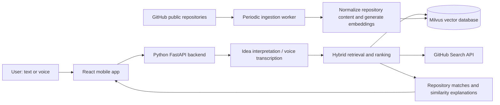

# RepoRadar

Turn a project idea into a search for existing open-source implementations.

RepoRadar is a planned AI-driven discovery service with a React-based mobile client and a Python FastAPI backend. Users describe an idea by text or voice; the backend combines semantic retrieval from Milvus with GitHub public repository search to find similar projects.

**Status:** repository scaffold and planning documentation only. No application features or services are implemented yet.

## Planned architecture



The backend and ingestion worker share integration code and one central backend configuration module. Provider choices, corpus boundaries, ingestion cadence, and ranking strategy remain open.

## Planned tools

| Component | Technology | Decision |
| --- | --- | --- |
| Backend API | Python, FastAPI | Confirmed |
| Mobile client | React ecosystem | Confirmed; React Native proposed |
| Semantic index | Milvus | Confirmed |
| Live repository retrieval | GitHub Search API | Confirmed |
| Embeddings, language model, voice transcription | Pending | Select after requirements |
| Tests | Unit and integration tests with TDD | Frameworks pending |

## Repository layout

```text
backend/
  app/
    api/           # HTTP endpoints
    core/          # Central backend configuration
    services/      # Idea processing, retrieval, ranking
    integrations/  # GitHub, Milvus, AI provider adapters
    workers/       # Periodic ingestion
  tests/
    unit/
    integration/
mobile/
  src/             # React mobile client
  tests/
infra/             # Deployment and local service configuration
docs/              # Detailed design documents
AGENTS.md          # Engineering workflow
REQUIREMENTS.md    # Technical requirements
SCOPE.md           # Plain-language scope
PROJECT_TRACKER.md # Phases, decisions, original prompts
```

## Development

Runtime setup instructions will be added when dependencies and the first runnable feature are introduced. Keep secrets in ignored environment files, use a central configuration module, and develop each feature through tests, a feature branch, a pull request, review, and merge.

## Phase progress

- Phase 0: initial folder scaffold and documentation prepared.
- Application implementation: pending further brainstorming and requirements.

See [technical requirements](REQUIREMENTS.md), [plain-language scope](SCOPE.md), and [project tracker](PROJECT_TRACKER.md).
