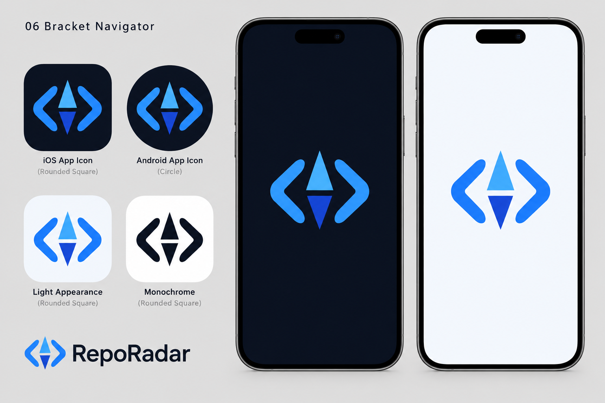

# RepoRadar visual direction

## Selected concept

On 2026-10-02, the user selected **Bracket Navigator**, a Code Compass variation featuring rounded code brackets around a two-tone compass needle. This is the agreed direction for RepoRadar's app icon and splash presentation.

The board is an AI-generated design reference, not an export-ready icon or a pixel-exact color specification. Generated using the built-in image-generation tool.

## Proposed color tokens

| Role | Color |
| --- | --- |
| Dark surface | Navy `#0B1220` |
| Dark accent | Electric blue `#58A6FF` |
| Light surface | Cool off-white `#F4F7FC` |
| Light accent | Cobalt `#245FCC` |

The selected visual direction establishes a dark-first identity with deliberate light-mode support. Exact foreground colors, needle facets, typography, and accessibility contrast remain to be verified during implementation.

## Platform implementation requirements

- Follow system appearance by default; provide System, Dark, and Light settings when the mobile theme is implemented.
- Preserve the same recognizable bracket-and-needle silhouette across light, dark, and monochrome variants.
- Export platform-specific assets from a clean master mark; do not crop the concept board into production assets.
- On iOS, let the system apply icon presentation and masks; prepare appropriate appearance variants and layers for the supported OS versions.
- On Android, provide adaptive foreground/background layers and a monochrome asset, with sufficient safe margins for different launcher masks.
- Keep Android's native splash minimal, using a centered mark and theme-matched background.
- Make the iOS native launch screen match the initial app layout. Any branded intro shown in the concept must be implemented as an app screen after native launch, without adding artificial startup delays.
- Verify small-size legibility, contrast, safe areas, appearance transitions, and actual behavior on iOS and Android before declaring assets production-ready.

Reference guidance: [Apple app icons](https://developer.apple.com/design/human-interface-guidelines/app-icons/), [Apple launching](https://developer.apple.com/design/human-interface-guidelines/launching), [Android splash screens](https://developer.android.com/develop/ui/views/launch/splash-screen).

## Generation brief

Create a RepoRadar brand concept board in electric blue on deep navy, with cool off-white light-mode counterparts. Use two substantial rounded opposing code brackets around a bold vertical two-tone compass needle, with a broad upward arrowhead, downward cobalt tail, and small negative-space break. Show iOS and Android icon-mask previews, light and monochrome variants, and centered dark/light splash concepts. Keep the mark consistent, uncluttered, and within mask-safe margins; keep wordmarks outside native splash previews.

## Remaining work

Vector master, production exports, theme tokens, mobile integration, and device validation are pending. No mobile runtime or launch screen has been implemented.
